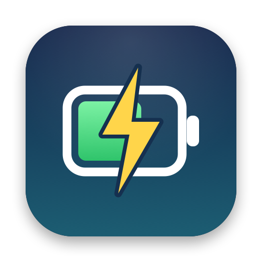
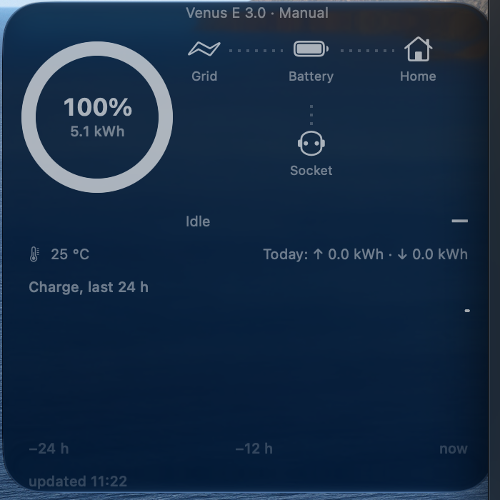

<p align="center">
  
</p>

<h1 align="center">MarstekBar</h1>

<p align="center">
  A macOS menu bar app and desktop widget for <b>Marstek Venus</b> home batteries,<br>
  using the battery's <b>local API</b>, with no cloud and no account.
</p>

<p align="center">
  <a href="https://github.com/KolyaSotnichenko/marstek-bar/actions/workflows/ci.yml"></a>
  
  <a href="LICENSE"></a>
</p>

<p align="center">
  
</p>

> **Unofficial.** MarstekBar is an independent project. It is not affiliated with,
> endorsed by, or supported by Marstek. "Marstek" and "Venus" are trademarks of their owner.

## Features

- **Desktop widget (large):** charge ring with stored kWh, power flow diagram
  (grid → battery → home, plus the battery's own socket), time remaining or time to
  full, battery temperature, today's charged/discharged energy and a 24-hour charge chart.
- **Menu bar item:** live charge percentage. Click it for the full dashboard.
- **Forecast that doesn't jump.** Power is smoothed over ~5 minutes and the reserve
  below your depth of discharge (DOD) is never counted as usable.
- **Read-only by design.** The app never sends a command that changes the battery.
  There is no code for `ES.SetMode`, `DOD.SET` or any other write method.
- **Local only.** It talks to the battery over UDP on your home network. When you're
  away, the widget shows the last known data and marks it as stale.
- **Ukrainian and English** interface (Settings → Language).

## Requirements

- macOS 14 Sonoma or later.
- A Marstek Venus battery on the same network as your Mac. Tested on **Venus E 3.0,
  firmware 150**. Other Venus models expose the same API (Venus C/E/A/D/E mini) but
  haven't been tested.
- **The battery's local API enabled** (UDP port 30000). Turn it on in the Marstek app
  if your firmware shows the option, or ask Marstek support. You can also use the
  community [BLE test tool](https://rweijnen.github.io/marstek-venus-monitor/).
- Xcode 16 or later and a free Apple ID, to build the app.

## Install (build from source)

There is no prebuilt download: distributing a signed, notarized app needs a paid Apple
Developer account. Building it yourself takes about five minutes.

1. Install [Xcode](https://apps.apple.com/app/xcode/id497799835) and add your Apple ID in
   **Xcode → Settings → Accounts**. A free "Personal Team" is enough.
2. Install [XcodeGen](https://github.com/yonaskolb/XcodeGen): `brew install xcodegen`
3. Clone and configure:
   ```sh
   git clone https://github.com/KolyaSotnichenko/marstek-bar.git
   cd marstek-bar
   cp Config/Local.xcconfig.example Config/Local.xcconfig
   ```
   Edit `Config/Local.xcconfig`: set `DEVELOPMENT_TEAM` to your Team ID (shown under
   your account in Xcode → Settings → Accounts) and `BUNDLE_ID_PREFIX` to something
   unique, e.g. `com.yourname`.
4. Build and install:
   ```sh
   xcodegen generate
   xcodebuild -project MarstekBar.xcodeproj -scheme MarstekBar -configuration Release \
     -derivedDataPath build -allowProvisioningUpdates build
   cp -R build/Build/Products/Release/MarstekBar.app /Applications/
   open /Applications/MarstekBar.app
   ```
5. When macOS asks, **allow access to the local network**. If you missed the prompt,
   enable MarstekBar in **System Settings → Privacy & Security → Local Network**.
6. Add the widget: right-click the desktop → **Edit Widgets** → **Marstek** → large size.

The app finds the battery automatically. If it doesn't, enter the battery's IP in
Settings. A DHCP reservation in your router keeps that IP from changing.

## Settings

| Setting | What it does |
|---|---|
| IP address / Port | The battery's address. *Find automatically* broadcasts on the network. |
| Depth of discharge | Should match the DOD in the Marstek app (factory default 88%). Used for "time remaining". |
| Invert power sign | Flip it if the arrows point the wrong way on your firmware. |
| Language | Українська, English, or follow the system. |
| Show in menu bar | Hide the icon; launch the app again to bring it back. |
| Open at login | On by default. |

## Troubleshooting

- **The widget's ring looks grey.** macOS draws inactive desktop widgets in a monochrome
  style. Click the desktop, or set **System Settings → Desktop & Dock → Widget style →
  Full-color**.
- **"—" in the menu bar / nothing found.** Check that the local API is enabled, that
  Local Network access is allowed, and that the Mac and the battery are on the same
  network. A 2.4 GHz and a 5 GHz network from the same router usually share one subnet.
- **The mode says "Manual" although the Marstek app is set to UPS.** The battery itself
  reports `Manual`: `ES.GetMode` has no UPS value.
- **Values are in brackets, e.g. "(64%)".** The data is more than 5 minutes old (Mac
  asleep or away from home).
- **The widget lags the menu bar by a few minutes.** That's intentional. macOS limits how
  often a widget may refresh, so the app only refreshes it when something visible changes,
  at most every 5 minutes.

## How it works

The battery speaks JSON-RPC over UDP ([Marstek Device Open API](https://static-eu.marstekcloud.com/ems/resource/agreement/MarstekDeviceOpenApi.pdf)).
Every 15 seconds the app asks `ES.GetStatus` and `Bat.GetStatus`, and `ES.GetMode`
every 5 minutes. Requests are spaced 1.5 s apart and retried, because the battery drops
roughly half of them. Missing fields keep their last known value. The menu bar app writes
a small JSON file into an App Group container; the widget only reads it and never touches
the network.

```
MarstekKit/   Swift package: protocol, UDP client, poller, forecast, history, all UI strings (tested)
App/          Menu bar app: polling, settings, writes the widget payload
Widget/       WidgetKit extension: reads the payload, renders the large widget
Shared/       SwiftUI dashboard used by both
scripts/      probe.py (read-only device probe), make-icon.swift (renders the app icon)
```

## Development

```sh
cd MarstekKit && swift test            # 81 tests, no Xcode project needed
swift run marstek-cli --watch          # poll your battery from the terminal
python3 scripts/probe.py --ip 192.168.1.50 --minutes 2   # raw CSV of what the battery reports
swift scripts/make-icon.swift          # re-render the app icon
```

Contributions are welcome, see [CONTRIBUTING.md](CONTRIBUTING.md). Reports from other
Venus models and firmware versions are especially useful.

## Known limitations

- The sign convention of `ongrid_power` / `offgrid_power` hasn't been confirmed on a
  charging or discharging battery yet. If arrows are reversed, use *Invert power sign*
  and please open an issue.
- How socket (off-grid) load combines with grid power while charging is unverified.
- No access from outside your home network (the API is LAN-only).

---

## Українською

MarstekBar показує стан домашньої батареї **Marstek Venus** у рядку меню і у великому
віджеті на робочому столі macOS. Він працює через **локальний API** батареї, без хмари.
Видно заряд, потужність і напрямок енергії, температуру, прогноз, на скільки вистачить
заряду, енергію за сьогодні і графік за 24 години. Додаток **лише читає** дані й нічого
не змінює в налаштуваннях батареї. Інтерфейс українською й англійською.

Встановлення описане вище в розділі [Install](#install-build-from-source). Потрібні Xcode,
безкоштовний Apple ID і ввімкнений локальний API на батареї (порт 30000).

## License

[MIT](LICENSE) © 2026 Mykola Sotnichenko
